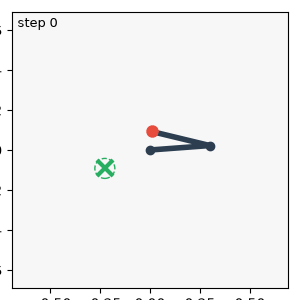
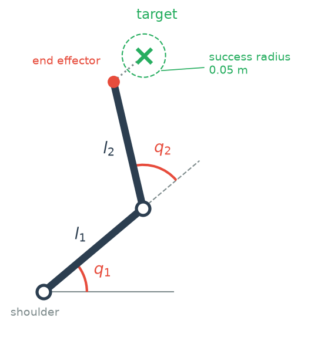
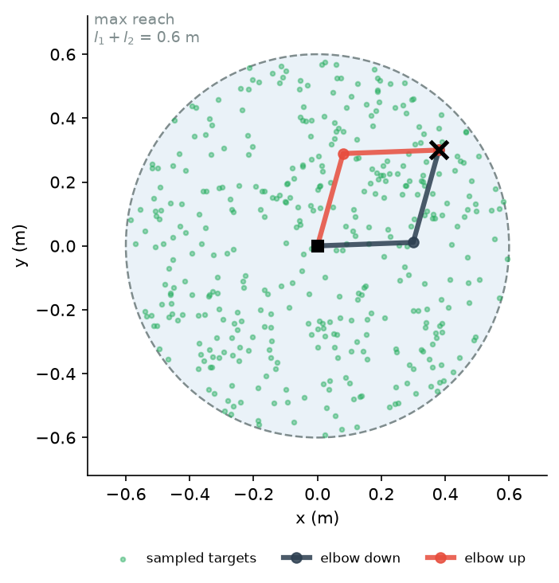
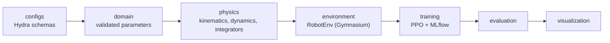
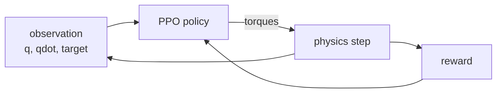
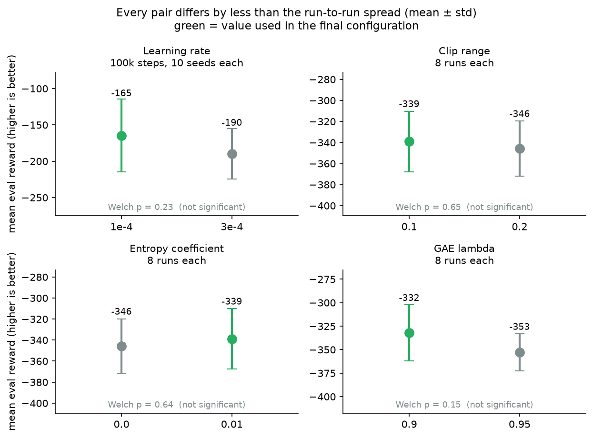

# Mech_RL

**Energy-aware reinforcement learning for a 2-DOF robotic arm.**


<p align="center">
  
  <br>
  <em>The trained policy reaching three targets (evaluation seeds 1–3). It reaches the target in 18 of 20 evaluation episodes; the other 2 time out.</em>
</p>

## What it does

Mech_RL trains a simulated two-joint robot arm to move its tip to a target using little effort and little time. The arm is a physics model written from first principles, wrapped as a Gymnasium environment and trained with PPO. Experiments are configured with Hydra and tracked with MLflow.

## How it works

### The arm

<p align="center"></p>

Two rigid links, each 0.3 m long and 1 kg. A motor at each joint applies a torque of up to 5 N·m. The physics follows the standard rigid-body equation of motion, with viscous joint friction $b = 0.05$:

$$M(q)\,\ddot q + C(q,\dot q)\,\dot q + G(q) + b\,\dot q = \tau$$

| Term | Meaning |
|---|---|
| $M(q)$ | Inertia matrix |
| $C(q,\dot q)\,\dot q$ | Coriolis and centrifugal torques |
| $G(q)$ | Gravity torques (gravity acts along −y) |
| $\tau$ | Joint torques chosen by the policy |

The equation is integrated with semi-implicit Euler (default) or RK4 at a 0.01 s time step. An episode lasts up to 1000 steps (10 s).

### The task

Each episode starts with random joint angles and a random target inside the arm's reach. The goal is to bring the end effector within 5 cm of the target.

<p align="center"></p>

Because both links are 0.3 m, every point within 0.6 m of the base is reachable. Most targets can be reached two ways (elbow up or elbow down), so the policy has to pick one.

| | Shape | Description |
|---|---|---|
| Observation `q` | 2 | Joint angles (rad), in [−π, π] |
| Observation `qdot` | 2 | Joint velocities (rad/s) |
| Observation `target` | 2 | Target position (x, y) in metres |
| Action | 2 | Torque at each joint, clipped to ±5 N·m |

An episode ends when the tip is within 5 cm of the target, or after 1000 steps.

### The reward

The reward trades accuracy against effort and speed. At every step:

$$r_t = -c_d\,d_t \;-\; c_e\,\lVert\tau_t\rVert^2 \;-\; c_s\,\lVert\tau_t-\tau_{t-1}\rVert^2 \;+\; c_b\,\mathbf{1}[d_t < 0.05] \;-\; c_t$$

where $d_t$ is the distance from the tip to the target.

| Term | Coefficient | Final value | Purpose |
|---|---|---|---|
| Distance | $c_d$ | 0.5 | Move toward the target |
| Effort | $c_e$ | 0.01 | Save energy: penalise large torques |
| Smoothness | $c_s$ | 0 | Penalise torque jumps (available, unused) |
| Success bonus | $c_b$ | 0 | Bonus on reaching the target (available, unused) |
| Time | $c_t$ | 0.01 | Reach the target sooner |

### Why PPO

The actions are continuous torques, so value-based methods such as DQN do not apply directly. PPO limits how far each update can move the policy, which keeps training stable when the reward mixes several competing terms. The policy is Stable-Baselines3's `MultiInputPolicy` with two hidden layers of 128 units.

## Architecture



Each layer builds only on the layers to its left. The physics layer uses NumPy only (no torch, Gymnasium or matplotlib), so the RL algorithm can change without touching the dynamics. All parameters are validated Pydantic models, and unknown keys are rejected at load time.

The training loop:



## Results

Final policy against a policy that applies random torques, over 20 evaluation episodes (seeds 0–19). Both use the same environment and reward.

| | Trained PPO | Random torques |
|---|---|---|
| Reaches the target | **90%** (18 / 20) | 60% (12 / 20) |
| Mean episode return | **−89.5** | −261.9 |
| Mean episode length (steps, max 1000) | **315** | 551 |

The numbers come from [`docs/assets/results.json`](docs/assets/results.json), written by `scripts/make_readme_figures.py`.

How to read them:

- **Return and speed show the gap best.** A random arm sweeps much of a 0.6 m workspace in 10 s, so it still hits a 5 cm target 60% of the time. The trained policy is about three times better on return and reaches the target in roughly half the steps.
- **This is one trained model (seed 42).** The 90% figure carries wide uncertainty with 20 episodes.
- **There is no classical-controller baseline yet.** A Jacobian or PD controller would likely do better on this simple task. See [Future work](#future-work).

### Final configuration

| PPO setting | Value | | Setting | Value |
|---|---|---|---|---|
| Learning rate | 1e-4 | | Training steps | 1,000,000 |
| Clip range | 0.1 | | Batch size | 64 |
| Entropy coefficient | 0.01 | | Rollout length (`n_steps`) | 2048 |
| GAE lambda | 0.9 | | Discount (`gamma`) | 0.99 |
| Network | [128, 128] | | Seed | 42 |

### What the sweeps showed

<p align="center"></p>

- **Reward coefficients mattered.** In the Day 9 sweeps, `distance_coef=0.5` beat 1.0 and 2.0, and `effort_coef=0.01` was the best value tested. A small time penalty helped slightly ([`Notes/Day_9.md`](Notes/Day_9.md)).
- **PPO settings did not separate clearly.** For learning rate, clip range, entropy coefficient and GAE lambda, the difference between the two tested values is smaller than the run-to-run spread. No comparison reached p < 0.05. GAE lambda is the closest (p ≈ 0.15), so the chosen values are best read as reasonable defaults rather than proven optima.

## Quick start

Requires Python 3.11 or newer.

```bash
git clone https://github.com/AMGhalcyon/Mech_RL.git
cd Mech_RL
python -m venv .venv
source .venv/bin/activate          # Windows: .venv\Scripts\activate
pip install -e ".[dev,video]"
```

### Train

```bash
python -m mech_rl.training.train reward.distance_coef=0.5 reward.time_penalty=0.01
```

The PPO defaults already match the final configuration. The reward defaults do not (`distance_coef=1.0`, `time_penalty=0.0`), so pass the tuned values as shown. A full run is 1M steps and takes a while; add `train.total_timesteps=100000` for a quick check.

Hydra saves the model to `outputs/<date>/<time>/model.zip`. MLflow logs runs to `mlruns/`; browse them with `mlflow ui`.

Override any parameter on the command line, or sweep with `--multirun`:

```bash
python -m mech_rl.training.train robot.l1=0.4 sim.integrator=rk4
python -m mech_rl.training.train --multirun train.clip_range=0.1,0.2 train.seed=0,1
```

### Evaluate

```python
from stable_baselines3 import PPO
from mech_rl.evaluation.final_eval import run_final_evaluation

model = PPO.load("outputs/<date>/<time>/model.zip")
summary = run_final_evaluation(model, output_dir="outputs/final_eval", num_episodes=20)
print(summary["success_rate"], summary["mean_reward"], summary["mean_episode_length"])
```

This reports success rate, mean return and episode length. It also tests robustness to different target positions and to ±5% link-length changes, and writes `eval_summary.json` and `report.html`. It evaluates with the tuned reward, so its returns match the table above.

### Test and regenerate figures

```bash
pytest tests/unit                       # 131 unit tests
python scripts/make_readme_figures.py   # needs a trained model in mlruns/
```

## Project layout

```text
src/mech_rl/
├── domain/          validated parameter models and state types
├── physics/         kinematics, dynamics, integrators (NumPy only)
├── environment/     RobotEnv, the Gymnasium environment
├── configs/         Hydra schemas; these hold the training defaults
├── training/        PPO entry point (train.py)
├── evaluation/      evaluation loop and final evaluation suite
├── tracking/        MLflow helpers
├── visualization/   training curves, GIFs, sweep analysis
└── utils/           paths, seeding, logging, config loading
configs/             YAML reference copies of the parameters
tests/unit/          unit tests for each layer
scripts/             README figure generator
docs/assets/         README figures
Notes/               day-by-day development log (Day 1–13)
```

## Limitations

- **Scope.** One planar 2-DOF arm with uniform rods. No 3D motion, multiple arms or hardware interface.
- **No disturbances.** Robustness tests vary targets and link lengths, but the simulator has no sensor noise, actuator delay or external forces.
- **Single seed.** The final model is one training run. The sweeps used few seeds, so most hyperparameter differences are inconclusive.
- **No working baseline.** `evaluation/baseline_benchmark.py` fails at its P-controller step (it indexes the dictionary observation as an array), so the README compares only against random torques.
- **Config files.** The YAML files in `configs/` are reference copies. Training reads its defaults from the schemas in `src/mech_rl/configs/`.

## Future work

- Add a classical baseline (Jacobian or PD controller) to the evaluation suite.
- Fix the baseline script and run it as part of `run_final_evaluation()`.
- Train several seeds of the final configuration and report the spread.
- Add sensor noise and disturbances to the environment.
- Extend the physics to three joints.

## Development log

[`Notes/`](Notes/) records each day of development, from the physics core through hyperparameter sweeps to the final evaluation suite.
